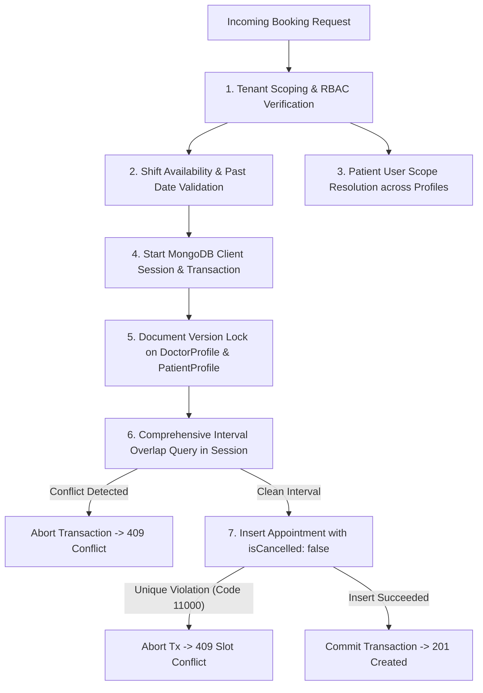

# MedCoreHMS — Appointment Concurrency & Conflict Prevention Architecture

- **Project:** MedCoreHMS
- **Specification:** PRD v1.0 Functional Source of Truth
- **Architecture Updated:** 2026-11-22
- **Target Engine:** MongoDB 7+ / Atlas (Replica Set) via Mongoose 8

---

## 1. Concurrency Problem Definition & Race Conditions

In high-concurrency hospital operations, three critical race conditions threaten clinical scheduling integrity:

1. **Doctor Double-Booking Race Condition:**  
   Two independent patients simultaneously observe an open 09:00 AM slot for Dr. Smith and submit booking requests at the exact same millisecond ($T_0$).  
   If the application only does a non-atomic "check-then-act" (`find` existing appointments, see 0, then `create`), both requests see an open slot, both create documents, and Dr. Smith is double-booked.

2. **Patient Multi-Doctor Overlap Race Condition:**  
   A patient concurrently books a 10:00 AM Cardiology consultation and a 10:00 AM Dermatology consultation across two different browser tabs. A human patient cannot physically be in two examination rooms simultaneously.

3. **Time Interval Partial Overlap:**  
   An existing appointment runs from 09:00 AM to 09:45 AM. A subsequent appointment request for 09:30 AM to 10:00 AM overlaps by 15 minutes. Simple equality checks fail to catch partial overlaps.

---

## 2. Multi-Layered MongoDB Concurrency Strategy

To guarantee zero double-booking and absolute race condition protection without relying on relational SQL locks (`SELECT ... FOR UPDATE`), MedCoreHMS implements a 4-tier concurrency defense:



---

### Layer 1: Valid MongoDB Compound Unique Partial Indexes

#### Critical Engine Constraint: No `$nin` in `partialFilterExpression`
MongoDB's `partialFilterExpression` specification strictly restricts supported operators to equality, `$exists: true`, `$gt`/`$gte`/`$lt`/`$lte`, `$type`, and top-level `$and`. Using `$nin` or `$ne` inside `partialFilterExpression` is rejected by MongoDB server with a `BadValue` exception.

MedCoreHMS resolves this cleanly using boolean equality tracking (`isCancelled: false` and `isDeleted: false`):

```typescript
// 1. Doctor Double-Booking Prevention Index (Valid MongoDB Equality Expression)
appointmentSchema.index(
  { hospitalId: 1, doctorId: 1, startTime: 1 },
  {
    unique: true,
    partialFilterExpression: {
      isDeleted: false,
      isCancelled: false,
    },
  },
);

// 2. Patient Overlap Prevention Index (Valid MongoDB Equality Expression)
appointmentSchema.index(
  { hospitalId: 1, patientId: 1, startTime: 1 },
  {
    unique: true,
    partialFilterExpression: {
      isDeleted: false,
      isCancelled: false,
    },
  },
);

// 3. Interval Query Optimization Indexes
appointmentSchema.index({
  hospitalId: 1,
  doctorId: 1,
  isCancelled: 1,
  isDeleted: 1,
  startTime: 1,
  endTime: 1,
});
appointmentSchema.index({
  hospitalId: 1,
  patientId: 1,
  isCancelled: 1,
  isDeleted: 1,
  startTime: 1,
  endTime: 1,
});
```

**Lifecycle Synchronization:**
- Newly booked active appointments initialize with `isCancelled: false`.
- When an appointment is cancelled, the controller transitions `status = 'CANCELLED'` and sets `isCancelled = true`.
- Once `isCancelled: true`, the appointment drops out of the partial index, immediately freeing the slot for new bookings.

---

### Layer 2: True Serialization of Partial Interval Overlaps via Document Locking

Exact-match unique indexes only catch collisions when two requests specify identical `startTime`. To prevent partial interval overlaps (e.g. 09:15–09:45 colliding with 09:00–09:30):

1. **Transactional Serialization**:
   Within a MongoDB multi-document transaction (`session.startTransaction()`), the booking controller issues an atomic update to both the doctor and all patient records associated with the patient account:
   ```typescript
   await DoctorProfile.updateOne(
     { _id: validated.doctorId, hospitalId: userHospitalId },
     { $inc: { bookingLockVersion: 1 } },
     { session }
   );
   await PatientProfile.updateMany(
     { userId: patient.userId, hospitalId: userHospitalId },
     { $inc: { bookingLockVersion: 1 } },
     { session }
   );
   ```
2. **Write Lock Effect**:
   MongoDB's WiredTiger engine acquires an exclusive document write lock on the target `DoctorProfile` and all sibling `PatientProfile`s. Any concurrent booking attempt for the same doctor or patient account is forced to wait or abort with `WriteConflict`.
3. **Serialized Interval Evaluation**:
   Under this exclusive lock, the interval query executes:
   $$\text{Overlap Condition: } (\text{startTime} < \text{req.endTime}) \land (\text{endTime} > \text{req.startTime})$$
   Because concurrent bookings are serialized, the second transaction reads the newly committed appointment and aborts with `409 DOCTOR_DOUBLE_BOOKING` or `409 PATIENT_OVERLAPPING_APPOINTMENT`.

---

### Layer 3: Comprehensive Patient Scheduling Scope

In a multi-hospital system, a single patient user may hold multiple patient profiles across different departments or hospitals. The booking engine resolves the patient's global identity:
- If `patient.userId` exists, the engine queries all patient profile IDs associated with that user.
- The patient conflict check evaluates interval collisions across all linked profiles:
  ```typescript
  const patientConflict = await Appointment.findOne({
    patientId: { $in: patientProfileIds },
    isDeleted: false,
    isCancelled: false,
    startTime: { $lt: validated.endTime },
    endTime: { $gt: validated.startTime },
  }).session(session);
  ```

---

### Layer 4: Bounded Retries, Transient Conflict Handling & Strict Non-Fallback

When concurrent requests race at the database engine level:
- **Bounded Retry for Transient Errors:** If WiredTiger encounters a `TransientTransactionError` or `WriteConflict`, the controller automatically retries the transaction up to 3 times with exponential backoff and jitter (`attempt * 50ms`), preventing false failures under high concurrency.
- **Duplicate Key Trapping:** Code `11000` (`MongoServerError`) is caught and classified by key pattern (`doctorId` -> `DOCTOR_DOUBLE_BOOKING`, `patientId` -> `PATIENT_OVERLAPPING_APPOINTMENT`).
- **Clean Abort:** Transactions are cleanly aborted via `session.abortTransaction()` in error blocks, leaving no phantom locks or orphaned reservations.
- **Strict Non-Fallback Policy:** If MongoDB transactions or sessions are unavailable, the engine **strictly rejects the booking** with `503 TRANSACTION_UNAVAILABLE`. There is **no unsafe non-transactional fallback** that would allow uncoordinated double-bookings.

---

## 3. Test Classification & Evidence Standards

MedCoreHMS enforces strict test classification rules:
1. **Mocked Controller Tests**: Vitest spies mock Mongoose methods (`findOne`, `create`) to verify HTTP response codes, error envelope structure, and business logic paths without invoking a database.
2. **In-Memory Tests**: Memory-based collections verify schema validations, Zod constraints, and model field transformations.
3. **Real MongoDB Integration Tests**: Execute against a live MongoDB daemon or Atlas cluster, verifying actual index creation, partial filter expressions, and transaction sessions.
4. **Real Database Concurrency Tests**: Two real network connections issuing simultaneous writes against MongoDB Atlas to prove WiredTiger index locks and code 11000 trapping.
