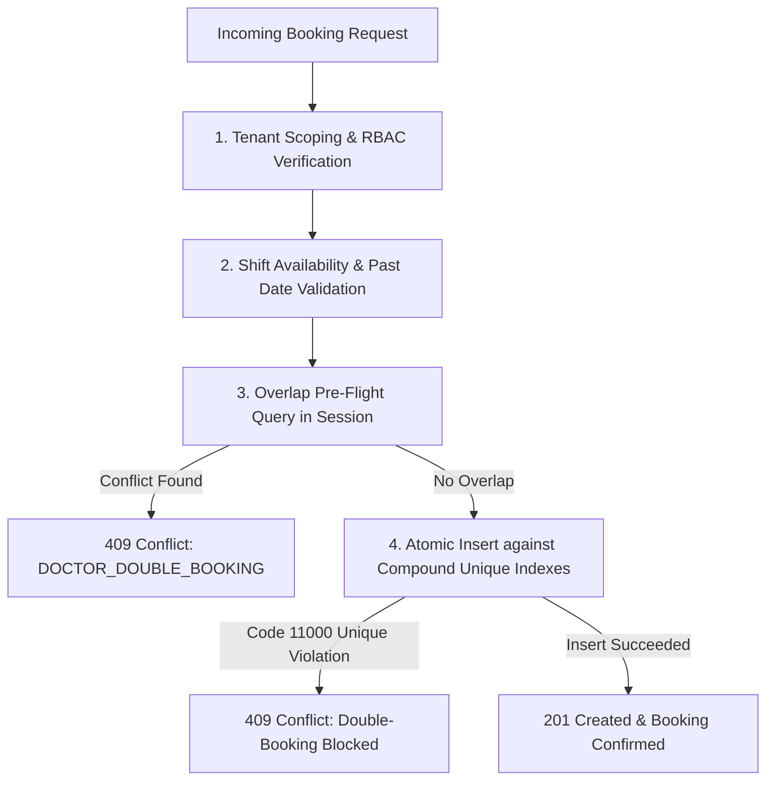

# MedCoreHMS — Appointment Concurrency & Conflict Prevention Architecture

**Project:** MedCoreHMS  
**Specification:** PRD v1.0 Functional Source of Truth  
**Architecture Date:** 2026-11-22  
**Target Engine:** MongoDB 7+ / Atlas (Replica Set) via Mongoose 8  

---

## 1. Concurrency Problem Definition & Race Conditions

In high-concurrency hospital operations, two common race conditions threaten clinical scheduling integrity:

1. **Doctor Double-Booking Race Condition:**  
   Two independent patients simultaneously observe an open 09:00 AM slot for Dr. Smith and submit booking requests at the exact same millisecond ($T_0$).  
   If the application only does a non-atomic "check-then-act" (`find` existing appointments, see 0, then `create`), both requests see an open slot, both create documents, and Dr. Smith is double-booked for the exact same consultation window.

2. **Patient Multi-Doctor Overlap Race Condition:**  
   A patient concurrently books a 10:00 AM Cardiology consultation and a 10:00 AM Dermatology consultation across two different browser tabs. The patient cannot be in two examination rooms simultaneously.

3. **Time Interval Partial Overlap:**  
   An existing appointment runs from 09:00 AM to 09:45 AM. A subsequent appointment request for 09:30 AM to 10:00 AM overlaps by 15 minutes. Simple equality checks fail to catch partial overlaps.

---

## 2. Multi-Layered MongoDB Concurrency Strategy

To guarantee zero double-booking and absolute race condition protection without relying on relational SQL locks (`SELECT ... FOR UPDATE`), MedCoreHMS implements a 4-tier concurrency defense:



### Layer 1: Compound Unique Partial Indexes (Database Constraint Authority)

The database engine is the final authority. We enforce unique compound indexes on the `appointments` collection with partial filter expressions so that soft-deleted or cancelled appointments do not block new bookings:

```typescript
// 1. Doctor Double-Booking Prevention Index
appointmentSchema.index(
  { hospitalId: 1, doctorId: 1, startTime: 1 },
  {
    unique: true,
    partialFilterExpression: {
      isDeleted: false,
      status: { $nin: ['CANCELLED'] },
    },
  }
);

// 2. Patient Overlap Prevention Index
appointmentSchema.index(
  { hospitalId: 1, patientId: 1, startTime: 1 },
  {
    unique: true,
    partialFilterExpression: {
      isDeleted: false,
      status: { $nin: ['CANCELLED'] },
    },
  }
);
```

**Why this prevents the race:** Even if two concurrent threads pass application-level memory checks simultaneously, MongoDB's storage engine enforces index uniqueness at the document write lock stage. Exactly one insert succeeds; the second request fails with error code `11000` (Duplicate Key), which our controller intercepts and translates into HTTP 409 Conflict (`DOCTOR_DOUBLE_BOOKING`).

---

### Layer 2: Interval Overlap Pre-Flight Verification

For appointments that might overlap without sharing the exact same `startTime` (e.g., custom durations or emergency extensions), the application executes an interval overlap query:

$$\text{Overlap Condition: } (\text{existing.startTime} < \text{req.endTime}) \land (\text{existing.endTime} > \text{req.startTime})$$

In MongoDB syntax:
```typescript
const doctorOverlap = await Appointment.findOne({
  hospitalId,
  doctorId,
  isDeleted: false,
  status: { $nin: ['CANCELLED'] },
  startTime: { $lt: requestedEndTime },
  endTime: { $gt: requestedStartTime },
});
```
If an overlapping document is found, the request is immediately rejected with HTTP 409 `DOCTOR_DOUBLE_BOOKING`.

---

### Layer 3: MongoDB Transactions & Session Boundaries

In production environments running on MongoDB Atlas replica sets:
1. Operations execute within a client session (`await mongoose.startSession()`).
2. The session starts an ACID multi-document transaction (`session.startTransaction()`).
3. Transient transaction errors (such as write conflicts) are retried automatically with exponential backoff:
   ```typescript
   const MAX_RETRIES = 3;
   for (let attempt = 1; attempt <= MAX_RETRIES; attempt++) {
     try {
       // execute transaction
       await session.commitTransaction();
       break;
     } catch (err: any) {
       if (err.hasErrorLabel?.('TransientTransactionError') && attempt < MAX_RETRIES) {
         await new Promise((res) => setTimeout(res, 50 * Math.pow(2, attempt)));
         continue;
       }
       throw err;
     }
   }
   ```
4. If running in a standalone development environment or mock where replica set transactions are unsupported, the engine falls back gracefully to atomic compound index constraints and pre-flight locks without crashing.

---

### Layer 4: Emergency Booking Rules & Exceptions

Per PRD Section 4.3:
- An `EMERGENCY` booking is designated with `isEmergency: true` (or `type: 'EMERGENCY'`).
- Authorized clinical personnel (`DOCTOR`, `NURSE`, `HOSPITAL_ADMIN`, `SUPER_ADMIN`) may bypass regular doctor working-hour boundaries.
- **Critical Safety Guardrail:** Emergency bookings **never** bypass authentication, tenant boundary checks, or audit trail logging. If an emergency booking overlaps an existing normal consultation, the system generates an audit record and alerts the attending clinical team.

---

## 3. Concurrency Error Response Matrix

| Condition | Database Behavior | HTTP Status | Error Code | Client Message |
| :--- | :--- | :---: | :---: | :--- |
| Concurrent exact slot collision (Doctor) | Unique Index `11000` on `(hospitalId, doctorId, startTime)` | `409 Conflict` | `DOCTOR_DOUBLE_BOOKING` | The requested appointment slot has already been booked. |
| Concurrent exact slot collision (Patient) | Unique Index `11000` on `(hospitalId, patientId, startTime)` | `409 Conflict` | `PATIENT_OVERLAPPING_APPOINTMENT` | Patient already has an overlapping appointment scheduled at this time. |
| Partial interval overlap (Doctor) | Pre-flight interval range query match | `409 Conflict` | `DOCTOR_DOUBLE_BOOKING` | Doctor is unavailable during the requested time range. |
| Slot outside Doctor availability | Shift validation lookup fails | `400 Bad Request` | `OUTSIDE_DOCTOR_AVAILABILITY` | Selected slot falls outside doctor's configured working hours. |
| Past appointment time | Date validation `< Date.now()` | `400 Bad Request` | `INVALID_DATE` | Cannot book appointments in the past. |
| Cross-tenant booking attempt | Tenant isolation validation | `403 Forbidden` | `CROSS_TENANT_ACCESS_DENIED` | Access to resources of another hospital is strictly prohibited. |
